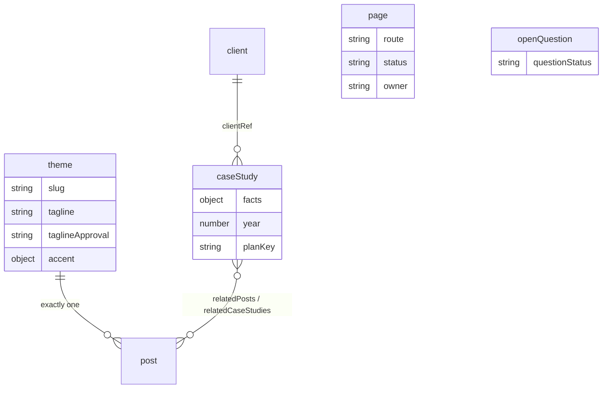

# darznieks.com

Personal site of Agris Dārznieks. Bilingual (English and Latvian) link-in-bio, with case studies at `/work` and writing at `/writing`. Content is edited in Sanity and the site is statically rendered, then refreshed on a short interval or when Sanity calls the revalidation webhook.

## Stack

Next.js 15 (App Router), React 19, TypeScript, Tailwind CSS v4, shadcn/ui, next-themes, Sanity v6. Hosted on Vercel, which deploys `main`. Studio schemas live in this repo; the hosted Studio is separate.

## Scripts

```bash
npm run dev        # local site
npm run build      # production build
npm run start      # serve the production build
npm run lint
npm run typecheck
```

Studio, when you need it locally: `npx sanity dev`. The hosted Studio is [darznieks.sanity.studio](https://darznieks.sanity.studio). It is linked from `/admin/studio` rather than embedded: Sanity Studio imports `useEffectEvent`, and Next.js 15.5.19’s compiled React does not export it, so embedding Studio fails the production build. Deploying the Studio (`npx sanity deploy`) publishes schema changes to the hosted Studio. Do that on purpose. Do not write to the production dataset from scripts.

```bash
npm test           # integrity checks and the auth guard
npm run test:e2e   # axe on the desk, behind a local test session
npm run test:bundle
```

## Environment

Copy `.env.example` to `.env.local`. The Sanity project id and dataset have public defaults. `NEXT_PUBLIC_GTM_ID` turns on Google Tag Manager and the consent banner. `SANITY_REVALIDATE_SECRET` signs the webhook that calls `POST /api/revalidate`.

Webhook (create, update, and delete):

- URL: `https://darznieks.com/api/revalidate`
- Secret: the same value as `SANITY_REVALIDATE_SECRET`
- Filter: `_type in ["post", "caseStudy", "theme", "client", "page", "siteSettings", "linkCard"]`
- Projection: `{_type, "slug": slug.current}`

## Routes

| Path | What it is |
| --- | --- |
| `/` | Redirects to `/en` or `/lv` from `Accept-Language` |
| `/[lang]` | Homepage |
| `/[lang]/work` and `/[lang]/work/[slug]` | Case studies |
| `/[lang]/writing` and `/[lang]/writing/[slug]` | Posts with a publish date |
| `/llms.txt`, `/robots.txt`, `/sitemap.xml` | Machine-readable extras |

`[lang]` is `en` (default) or `lv`. Pages are generated at build time and revalidated about once a minute, or immediately when the webhook runs.

`/admin` is the private desk. It is not in the sitemap, it sends `noindex`, and middleware plus the server layout both require the allowlisted GitHub account. A theme hub is a public route only when it has at least one published post. Base is not a hub.

## Desk environment

Copy the names from `.env.example`. Agris sets the values in Vercel. Nothing here is a secret.

| Variable | Where it is used |
| --- | --- |
| `AUTH_SECRET` | Auth.js session encryption. `openssl rand -base64 32`. |
| `AUTH_GITHUB_ID` | GitHub OAuth client id. |
| `AUTH_GITHUB_SECRET` | GitHub OAuth client secret. Server only. |
| `ADMIN_GITHUB_LOGIN` | The one GitHub username that may sign in, for example `agrisdarznieks`. |
| `SANITY_API_READ_TOKEN` | Reads drafts for the desk and for preview. Viewer permission is enough. Server only. |
| `SANITY_API_WRITE_TOKEN` | Creates and publishes drafts from the desk. Editor permission. Server only. Never exposed to the browser. |
| `SANITY_REVALIDATE_SECRET` | Existing webhook secret. |

`ADMIN_E2E`, `ADMIN_E2E_TOKEN`, and `ADMIN_E2E_FIXTURES` are for local Playwright only. The desk turns them off when `VERCEL` or `VERCEL_ENV` is set. Do not add them in Vercel.

### What Agris does himself

1. Create a GitHub OAuth app. Homepage `https://darznieks.com`. Callback `https://darznieks.com/api/auth/callback/github`. Add the Vercel preview origin as a second callback when a preview needs sign-in.
2. In Vercel, set the variables above for Production and Preview. Redeploy after they are saved.
3. In Sanity, create a token with Viewer rights (`SANITY_API_READ_TOKEN`) and a token with Editor rights (`SANITY_API_WRITE_TOKEN`). Do not use a token that can delete the dataset.
4. In Sanity → API → CORS origins, add `https://darznieks.com` and the preview origin, with credentials allowed. The hosted Studio signs in with your Sanity user. The write token stays on the server and is used only by the desk forms.
5. When the schema should appear in the hosted Studio, run `npx sanity deploy` on purpose.
6. To add the theme and page documents without touching anything that already exists: `node scripts/seed-content-model.mjs`, read the dry run, then `SEED_CONFIRM=create-missing-only node scripts/seed-content-model.mjs --apply --dataset production`. The script only calls `createIfNotExists`. Taglines it would insert are unapproved drafts.

The desk can save drafts, move them to review, and publish. Publishing asks for an explicit confirmation. Preview uses Next.js draft mode and rewrites the public URL to a dynamic preview route, so the public pages themselves never read the draft cookie.

## Content model



A post requires one `theme` reference. A case study points at a `client` document, and its `facts` object records what may be public, the role, the year, image clearance, and confidentiality. Pages carry `status` (`draft`, `review`, `published`) and `owner`. Rich text stays in Studio.

Conventions, accessibility, and things not to change are in [AGENTS.md](./AGENTS.md).
